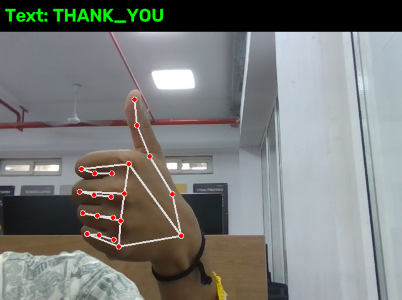
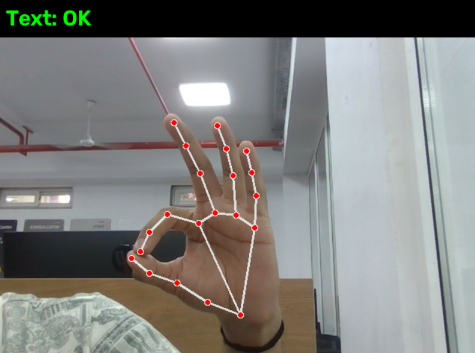
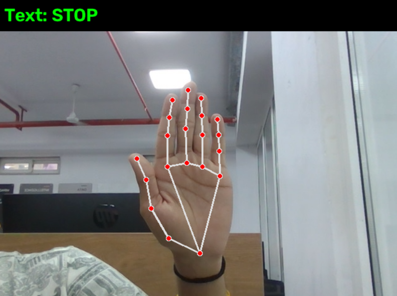

# Sign Language to Speech/Text Translator

A real-time prototype that recognizes static hand gestures from a webcam and converts them into on-screen text and spoken words. Built with **MediaPipe Hands**, **OpenCV**, **scikit-learn** and **pyttsx3**.

> IML mini project by Harshil Shah and Dhruvil Patel.

  

## How it works

```
Webcam frame -> MediaPipe Hands (21 landmarks) -> Normalize (63 features)
             -> Random Forest -> Smoothing -> Text + Speech
```

1. MediaPipe Hands finds 21 hand landmarks in each frame.
2. Landmarks are made relative to the wrist and scaled, giving 63 position- and size-independent features.
3. A Random Forest (200 trees) predicts the gesture.
4. A confidence threshold (0.7) and a majority vote (8 of the last 10 frames) stabilize the output.
5. The word is shown on screen and spoken with pyttsx3 (offline).

## Gestures

HELLO, YES, NO, THANK_YOU, OK, STOP. These are static hand shapes chosen for this demo (for example open palm, thumbs-up, "OK" circle, flat palm). **They are not official signs of ASL or Indian Sign Language.** You can record any gestures you like.

## Setup

Requires **Python 3.12** and a webcam. Newer MediaPipe releases removed the API used here, so keep the pinned version and use Python 3.9 to 3.12.

```bash
git clone https://github.com/harshil-shah-06/Sign_Language_Translator_IMLMini_Project.git
cd Sign_Language_Translator_IMLMini_Project
python -m pip install -r requirements.txt
```

On Windows with several Python versions, use `py -3.12` instead of `python`.

## Usage

Run all commands from the repository root.

**1. Record samples** (one run per gesture; press SPACE to start/stop recording, Q to quit; about 300 samples each):

```bash
python src/1_collect.py HELLO
python src/1_collect.py YES
python src/1_collect.py NO
python src/1_collect.py THANK_YOU
python src/1_collect.py OK
python src/1_collect.py STOP
```

Samples are appended to `data.csv` (landmark numbers only; no images or video are saved).

**2. Train:**

```bash
python src/2_train.py
```

Prints accuracy and a per-gesture report and saves `model.pkl`.

**3. Run live recognition** (Q to quit):

```bash
python src/3_run.py
```

Hold each gesture steady for about a second. Use the same hand, lighting and distance as in training.

## Results

| Item | Value |
|---|---|
| Gestures | 6 |
| Samples | 1,981 (313 to 346 per gesture) |
| Test split | stratified 20% (397 samples) |
| Test accuracy | 100% |

**Read this number carefully.** The data are consecutive webcam frames from one person in one room, and a random split puts near-identical frames in both train and test sets. The 100% shows that the pipeline works and that the gestures are separable, not that the system is 100% accurate for other users, lighting or cameras. Latency was not measured.

## Limitations

- Static gestures only (no motion, so signs like the real ASL "thank you" are not supported).
- One hand, small fixed vocabulary, one user recorded.
- Needs MediaPipe to detect the hand (good light, hand in frame).
- Not a replacement for an interpreter in medical, legal or emergency situations.

## Future work

Multi-user and multi-session evaluation, real sign vocabularies developed with signers, sequence models (LSTM/Transformer) for motion and sentences, two-hand and facial features, a mobile app, and multiple sign languages.

## Project structure

```
src/1_collect.py   record landmark samples for one gesture
src/2_train.py     train and evaluate the Random Forest
src/3_run.py       live recognition with text and speech
paper/             IEEE paper source (LaTeX, upload to Overleaf)
docs/images/       demo screenshots
requirements.txt   pinned dependencies
```

## Paper

The IEEE-format paper is in `paper/main.tex` (upload the `paper` folder to Overleaf and compile with pdfLaTeX).

## Reference

Zhang, F. et al. *MediaPipe Hands: On-device Real-time Hand Tracking.* arXiv:2006.10214, 2020.

## License

MIT, see [LICENSE](LICENSE).
